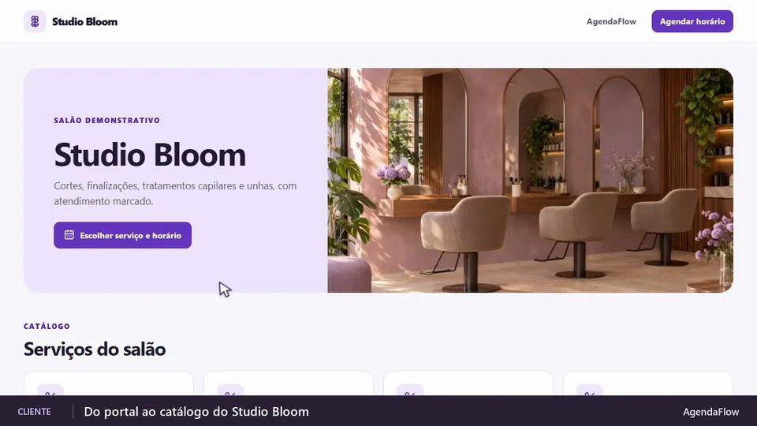
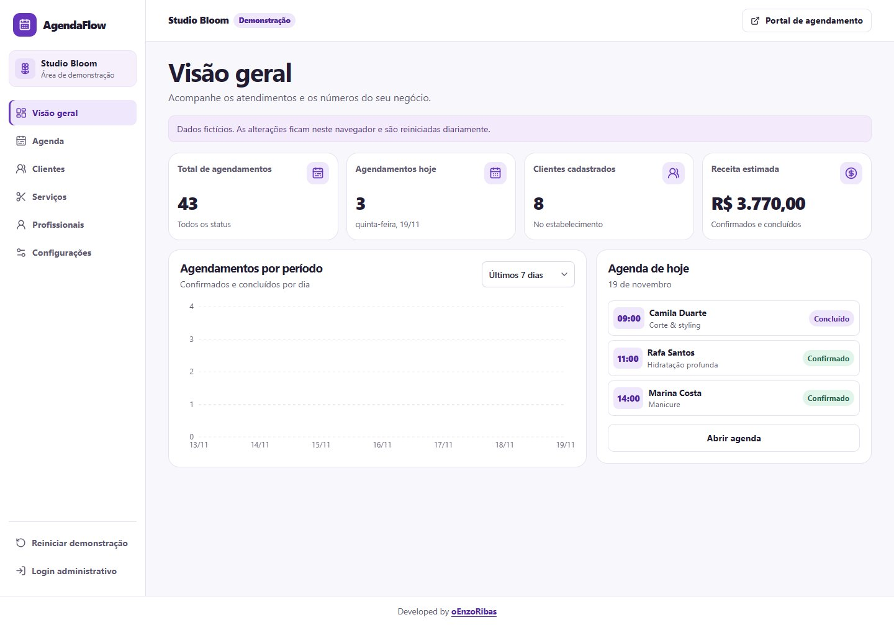
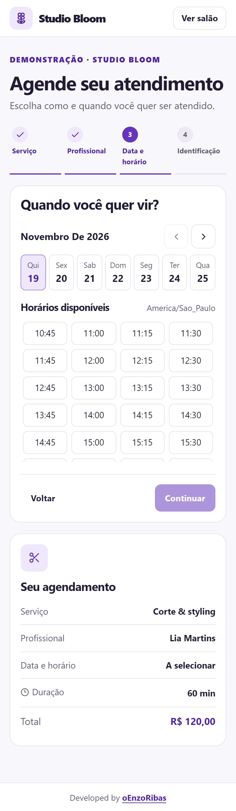
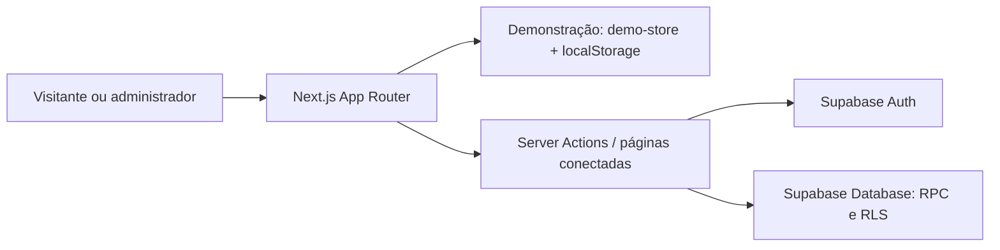

# AgendaFlow

[](package-lock.json)
[](package.json)
[](package.json)
[](.github/workflows/ci.yml)

O AgendaFlow organiza os agendamentos de pequenos negócios. Clientes escolhem serviço, profissional e horário pelo portal. A equipe consulta a agenda e administra atendimento, oferta e disponibilidade no painel.

O **Studio Bloom** é o salão fictício da demonstração. O fluxo local pode ser explorado sem conta e sem Supabase. O modo conectado usa Supabase Auth e PostgreSQL.

## Demonstração da Plataforma

No Studio Bloom, Helena Dias escolhe um corte, consulta os horários de Lia Martins e confirma sua reserva. A equipe abre o mesmo atendimento na agenda e consulta os indicadores do salão. Os dados exibidos são fictícios.



[Assistir no navegador](https://cdn.jsdelivr.net/gh/oEnzoRibas/AgendaFlow@main/docs/media/demo.mp4) · [Baixar o vídeo completo em MP4](docs/media/demo.mp4?raw=1) · 37 segundos · 720p · sem áudio

## Funcionalidades

- Catálogo e agendamento com seleção de serviço, profissional, data e horário.
- Painel com indicadores, gráfico por período e visões diária e semanal.
- Remarcação, cancelamento, busca de clientes e configuração de serviços, profissionais, expediente e bloqueios.
- Disponibilidade calculada no fuso do estabelecimento. A reserva conectada é revalidada em transação e o banco impede sobreposições por profissional.
- Demonstração isolada no navegador, com dados fictícios, renovação diária e reinício manual.

## Capturas de tela

| Painel em desktop | Horários no celular |
| --- | --- |
|  |  |

Veja a [galeria de capturas reais](docs/screenshots/README.md), com landing mobile, catálogo, agenda semanal e confirmação.

## Executar localmente

Use **Node.js 24** (mínimo 22) e npm. Docker é necessário apenas para o Supabase local.

```bash
git clone https://github.com/oEnzoRibas/AgendaFlow.git
cd AgendaFlow
npm ci
npm run dev
```

Abra [localhost:3000](http://localhost:3000). A landing fica em `/`, o salão em `/estudio`, a reserva fictícia em `/agendar` e o painel demonstrativo em `/demo/painel`. Para habilitar `/login` e `/agendar?modo=real`, copie `.env.example` para `.env.local`, aplique a migração e vincule o proprietário conforme o [guia de instalação](docs/getting-started.md).

## Arquitetura



O Next.js 16 e o React 19 renderizam o portal e o painel. TypeScript e Zod definem os contratos, React Hook Form gerencia o formulário de reserva, Tailwind CSS e Radix UI sustentam os componentes visuais, date-fns trata datas e Recharts exibe os indicadores. As versões resolvidas estão no [lockfile](package-lock.json).

| Diretório | Responsabilidade |
| --- | --- |
| [`app/`](app/) | Rotas, layout, metadados, estilos e Server Actions |
| [`components/`](components/) | Portal, formulários, painel e componentes de interface |
| [`lib/`](lib/) | Contratos, horários, demonstração e integração Supabase |
| [`supabase/`](supabase/) | Configuração local, migração SQL e carga inicial |
| [`tests/`](tests/) | Regras de agenda e integração com Supabase local |
| [`docs/`](docs/) | Arquitetura, operação, decisões e capturas |

## Desenvolvimento e publicação

```bash
npm run lint
npm run typecheck
npm test
npm run build
npm start
```

O [guia de testes](docs/testing.md) explica como executar a integração local. O [guia de deploy](docs/deployment.md) cobre build, variáveis, migrações e verificações em um host Node.js. A CI compila e valida o projeto sem acesso a um banco de produção.

## Segurança e limites

O acesso administrativo exige sessão Supabase Auth e vínculo de proprietário. RLS limita as leituras administrativas. As gravações passam por funções SQL com validação e escopo explícitos. Use o [canal de segurança](SECURITY.md) para relatos privados.

Cada instância Next.js aponta para um slug de estabelecimento. O expediente aceita uma faixa por dia, as vagas partem de uma grade de 15 minutos e a consulta cobre a data atual e os 60 dias seguintes. A receita do painel é uma estimativa. Consulte o [registro de auditoria](docs/audit.md) para riscos, limites operacionais e pontos de evolução.

## Roadmap

- Avaliar proteção contra abuso no fluxo público e telemetria que preserve a privacidade.
- Avaliar expediente em múltiplas faixas e paginação de dados na interface.
- Avaliar testes de interface automatizados e integração com Supabase descartável na CI.

Itens propostos para discussão, sem prazo assumido.

## Contribuição e licença

Consulte [CONTRIBUTING.md](CONTRIBUTING.md) e o [Código de Conduta](CODE_OF_CONDUCT.md). As mudanças estão no [changelog](CHANGELOG.md). A adoção da MIT está pendente de confirmação da titularidade e aprovação da [proposta de licença](docs/decisions/mit-license-proposal.md).

## Desenvolvedor

**oEnzoRibas** · [GitHub](https://github.com/oEnzoRibas)

Responsável pela direção do produto e indicado como mantenedor do AgendaFlow. O crédito **Developed by oEnzoRibas** acompanha as interfaces. O histórico Git registra os commits do repositório. A imagem do salão foi criada para o projeto com geração de imagens.

[Índice da documentação técnica](docs/README.md)
