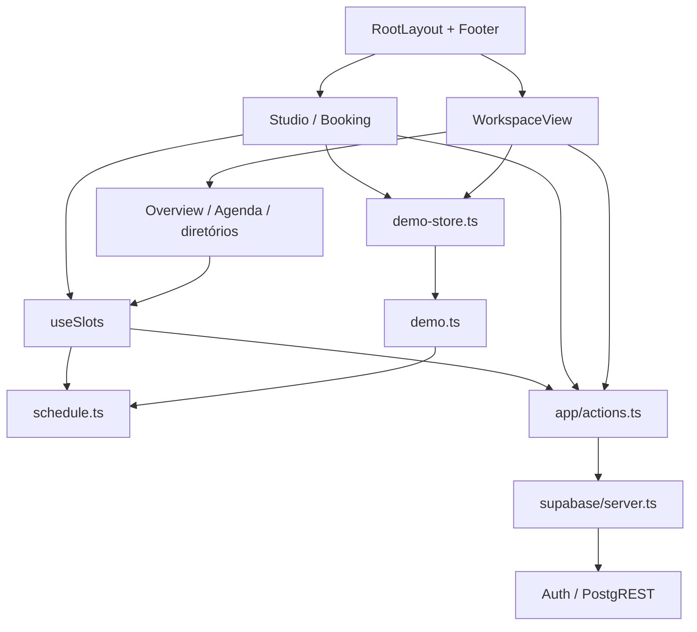

# Arquitetura

O AgendaFlow é uma aplicação Next.js com dois caminhos para o mesmo domínio de agenda. A demonstração usa funções TypeScript e armazenamento do navegador. No modo conectado, páginas e ações passam pelo Supabase, e o PostgreSQL decide se uma reserva pode ser gravada.

## Componentes e dependências

| Camada | Responsabilidade |
| --- | --- |
| Rotas de `app/` | Escolhem o modo, carregam catálogo ou dados administrativos, tratam páginas desconhecidas e condicionam acesso |
| Componentes | Gerenciam formulários, navegação, estados de carregamento, erros acionáveis e confirmação |
| Domínio TypeScript | Zod valida contratos. `schedule.ts` converte datas locais e calcula vagas da demo. `demo.ts` transforma dados fictícios |
| Integração Supabase | Ação do servidor seleciona o cliente público ou o de sessão. O proxy sincroniza cookies nas rotas administrativas |
| PostgreSQL | Resolve catálogo, disponibilidade, reserva e mutações administrativas, com autorização, transação e restrições |

A seta para `app/actions.ts` representa o conjunto de ações. `Booking` usa `submitBooking` e o hook de horários, enquanto `WorkspaceView` usa `manage` e `signOut`. Rotas também consultam Supabase diretamente no servidor para renderizar catálogo e dados administrativos.

## Decisões e trade-offs

- O App Router reúne páginas estáticas e rotas dependentes de sessão. Os componentes clientes são usados nas etapas da reserva e nas interações do painel. O layout compartilha marca, metadados e o crédito de manutenção.
- Zod valida entradas de rede e de mutações demonstrativas. Schemas explícitos reduzem o acoplamento entre campos de formulário e os argumentos das RPCs.
- Centralizar a reserva conectada no PostgreSQL evita a janela entre consultar e gravar em processos diferentes. O lock é por estabelecimento. O ganho de simplicidade reduz o paralelismo de escritas no mesmo salão.
- A demo sem conta reduz a dependência operacional do portfólio. A manutenção precisa preservar a paridade entre as regras demonstrativas e as regras SQL nos pontos compartilhados.
- O painel administrativo lê páginas de 500 registros do banco e entrega um workspace completo ao cliente. O desenho é adequado para o escopo inicial de pequeno negócio. Filtros e paginação no servidor podem reduzir payloads grandes futuramente.
- As funções de negócio retornam erros esperados no formato `Result`; falhas inesperadas de carregamento chegam ao boundary. A interface apresenta mensagens curtas. A investigação técnica deve usar logs do servidor sem incluir o conteúdo de formulários ou credenciais.

## Extensão

Adicione uma seção ao mapa `lib/sections.ts` e à navegação de `WorkspaceView`. Para mutações, comece pelo schema em `lib/model.ts`, reflita a alteração em `simulateManagement` e crie uma migração para a RPC. Atualize os tipos Supabase, o contrato e a cobertura da regra alterada. Consulte o [guia do código-fonte](codebase-guide.md) e as [decisões](decisions/README.md).
