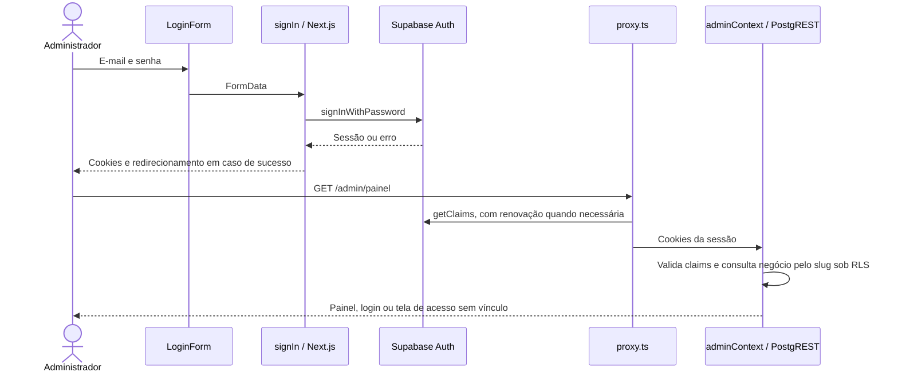

# Autenticação e autorização

O AgendaFlow usa Supabase Auth com e-mail e senha. A conta é provisionada fora da aplicação. O ID de Auth precisa corresponder a `businesses.owner_id` para o slug configurado.

A criação do cliente SSR liga os cookies do Next ao SDK, que controla a renovação. O proxy também propaga cookies atualizados para o processo de renderização do servidor. Em páginas e ações administrativas, `adminContext` verifica claims novamente e consulta o estabelecimento. A função SQL `manage_agenda` repete o controle de proprietário antes de mutar.

O logout encerra a sessão local e redireciona para `/login`. A demonstração não usa conta. O portal público usa um cliente sem sessão, inclusive quando o visitante tem sessão administrativa no navegador. Consulte a [referência de operações](api-reference.md) e o [guia de provisionamento](getting-started.md).

Referência oficial da [integração Supabase SSR](https://supabase.com/docs/guides/auth/server-side/creating-a-client).
