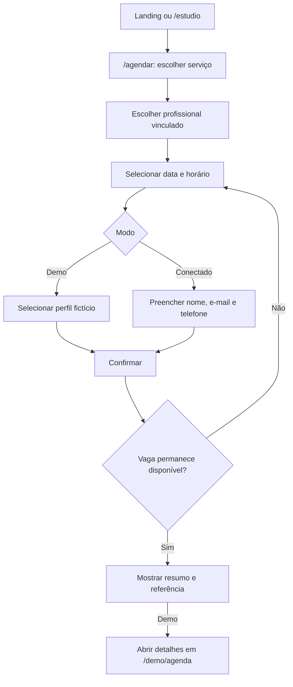
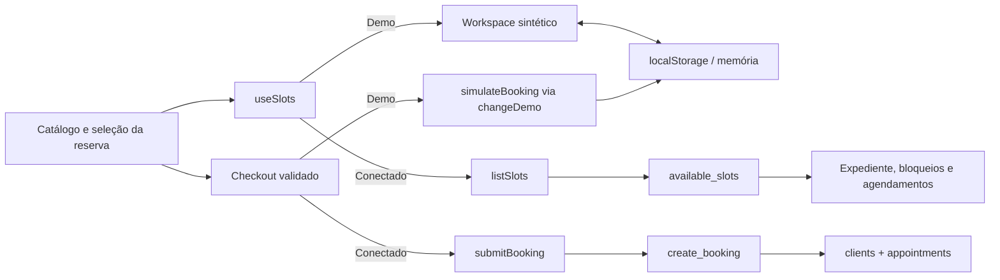
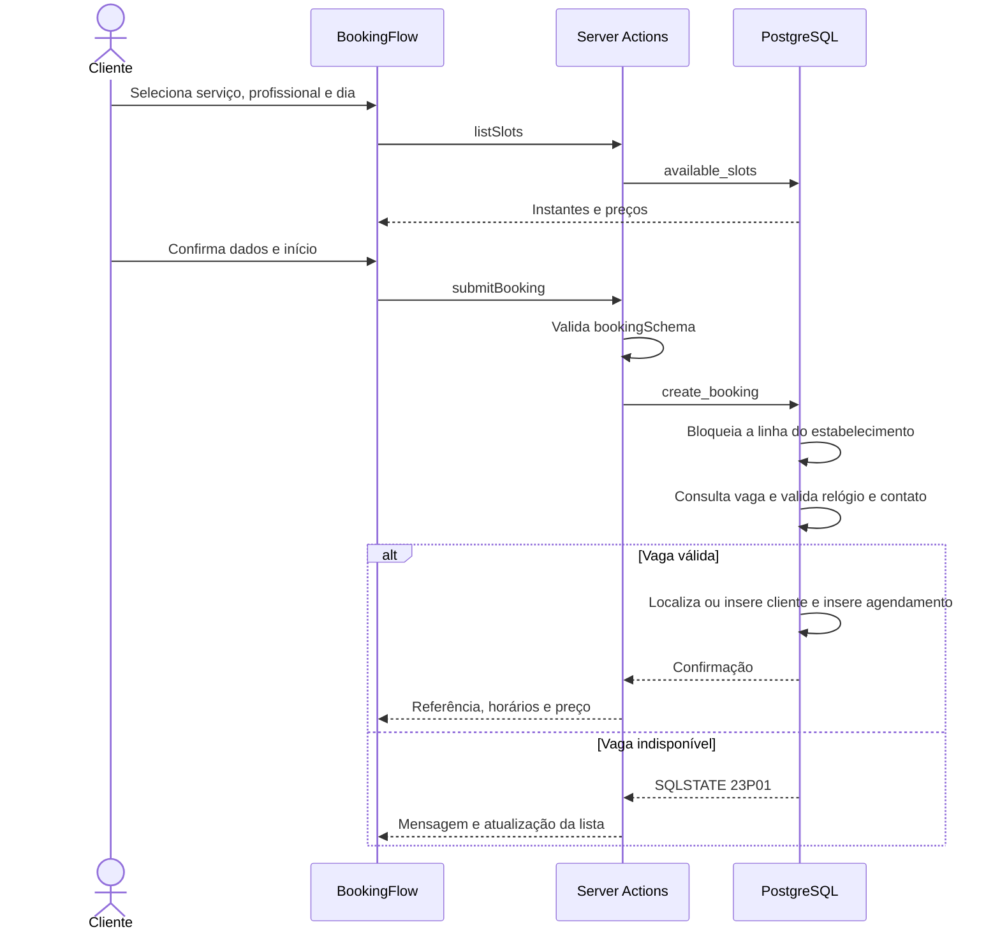

# Fluxos de dados

## Jornada da reserva

A demonstração revalida em TypeScript com o snapshot atual. O modo conectado carrega catálogo no servidor, consulta disponibilidade por ação e envia a confirmação para PostgreSQL. Em caso de conflito, a interface retorna à seleção e atualiza as vagas.

## Dados por origem e destino

A persistência demonstrativa é isolada por origem do navegador e retorna à base inicial quando o snapshot do dia deixa de ser válido. A instalação conectada guarda registros em PostgreSQL. Somente a leitura administrativa autorizada recebe contatos cadastrados.

## Sequência de reserva conectada

A confirmação apresenta apenas os campos necessários ao resumo. A associação a cliente existente usa o e-mail normalizado no mesmo estabelecimento.
