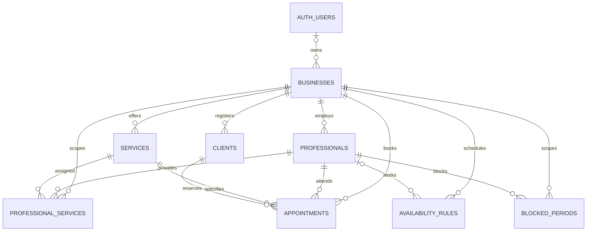

# Banco de dados

A [migração inicial](../supabase/migrations/20261119000100_agendaflow.sql) cria o schema de domínio em `public`. A configuração local usa PostgreSQL 17. O schema de identidade `auth.users` pertence ao Supabase Auth.

| Entidade | Campos e integridade |
| --- | --- |
| `businesses` | Slug único, proprietário opcional, nome, descrição, fuso IANA, intervalo e flag de reserva pública |
| `services` | Nome, descrição, duração de 5 a 480 minutos, valor em centavos e estado ativo |
| `professionals` | Nome, especialidade e estado ativo |
| `professional_services` | Relação N:N com chave composta pelo negócio, profissional e serviço |
| `clients` | Nome, e-mail normalizado único no negócio e telefone |
| `availability_rules` | Um registro por dia e profissional. Profissional nulo representa o expediente do salão. Domingo é 0 |
| `blocked_periods` | Profissional, início, fim e motivo, com período finito e crescente |
| `appointments` | Cliente, serviço e profissional do mesmo negócio. Início, fim, ocupação, valor histórico e estado |

As FKs compostas impedem vínculos cruzados entre estabelecimentos. Horários agendados são `timestamptz`; a interpretação civil usa o fuso de `businesses`. Índices atendem consultas por proprietário, agenda, cliente, serviço e bloqueio. A carga inicial inclui salão, equipe, catálogo, atribuições e horários. O negócio começa sem proprietário e fechado para reservas públicas.

## Disponibilidade e concorrência

1. A função cruza expediente com turno do profissional, exige serviço e profissional ativos e vinculados, e gera vagas de 15 em 15 minutos a partir da abertura efetiva. A duração do serviço precisa caber antes do fechamento. A consulta aceita a data atual até 60 dias adiante e elimina instantes passados.
2. Compara `[starts_at, busy_until)` aos outros atendimentos e bloqueios. `busy_until` inclui o intervalo após o serviço. Limites adjacentes são compatíveis. O fim do atendimento deve caber no expediente, e o intervalo pode ir além do fechamento.
3. `create_booking` e `manage_agenda` tomam lock na linha do estabelecimento. A reserva recalcula a vaga dentro da transação e confirma novamente o relógio. A constraint de exclusão GiST sobre profissional e `tstzrange` protege o estado final contra sobreposição.
4. Cancelamentos deixam de ocupar disponibilidade. Remarcações repetem a seleção com exclusão da própria reserva, recalculam os horários e preservam o preço gravado. O status concluído continua considerado no cálculo quando seu intervalo intersecta uma consulta.

## Controle de acesso

As tabelas de domínio têm RLS. O papel autenticado recebe leitura sob escopo de proprietário. O papel anônimo consulta catálogo e vagas por RPC e pode criar novas reservas no estabelecimento aberto. As tabelas mantêm dados identificáveis atrás das permissões administrativas. As RPCs de escrita usam `SECURITY DEFINER`, `search_path` vazio, nomes qualificados e grants explícitos. Veja [autenticação](authentication.md) e [segurança](security.md).
