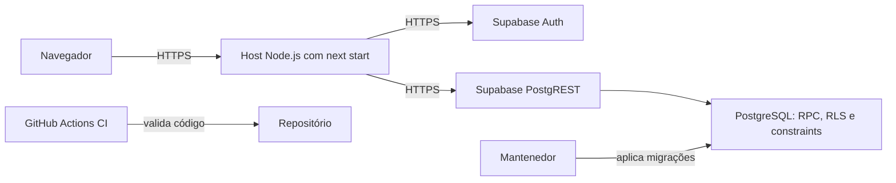

# Deploy

## Topologia de referência

O repositório contém CI e instruções de publicação. O workflow não realiza deploy. Para a demonstração basta o host Next.js. O modo conectado exige um projeto Supabase.

## Procedimento

1. Use Node.js 24 no ambiente de build. Execute `npm ci`, `npm run lint`, `npm run typecheck` e `npm test`.
2. Para o modo conectado, vincule a CLI com `npx supabase@3.2.0 link --project-ref <referência>`. Confira o alvo com `npx supabase@3.2.0 db push --dry-run --remote` e aplique com `npx supabase@3.2.0 db push --remote`. O SQL Editor é uma alternativa para um projeto novo. Use uma estratégia única para manter o histórico de migrações coerente.
3. Em um projeto isolado de demonstração, aplique opcionalmente `supabase/seed.sql`. Em um projeto real, cadastre o negócio e suas relações de acordo com o schema. Crie a conta, vincule o proprietário e confirme a configuração de Auth no projeto de destino.
4. Configure URL, chave publicável e slug no host. As variáveis `NEXT_PUBLIC_*` precisam estar disponíveis no build. Rode `npm run build` e `npm start`, ou use os equivalentes do provedor gerenciado. Sirva por HTTPS.
5. Teste a landing, a demo, o login, o acesso sem sessão e o catálogo conectado. Faça reservas de smoke test em staging com contatos fictícios. Abra reservas reais somente após validar a configuração.
6. Para voltar uma versão da aplicação, publique novamente o artefato anterior e confirme compatibilidade com o schema atual. Mudanças de banco pedem backup, plano de recuperação e, quando necessário, migração corretiva.

A branch de release deve apontar para a versão validada. O [changelog](../CHANGELOG.md) separa lançamentos de mudanças em andamento. [CLI e alvos Supabase](https://supabase.com/docs/guides/local-development/local-and-hosted-projects).
